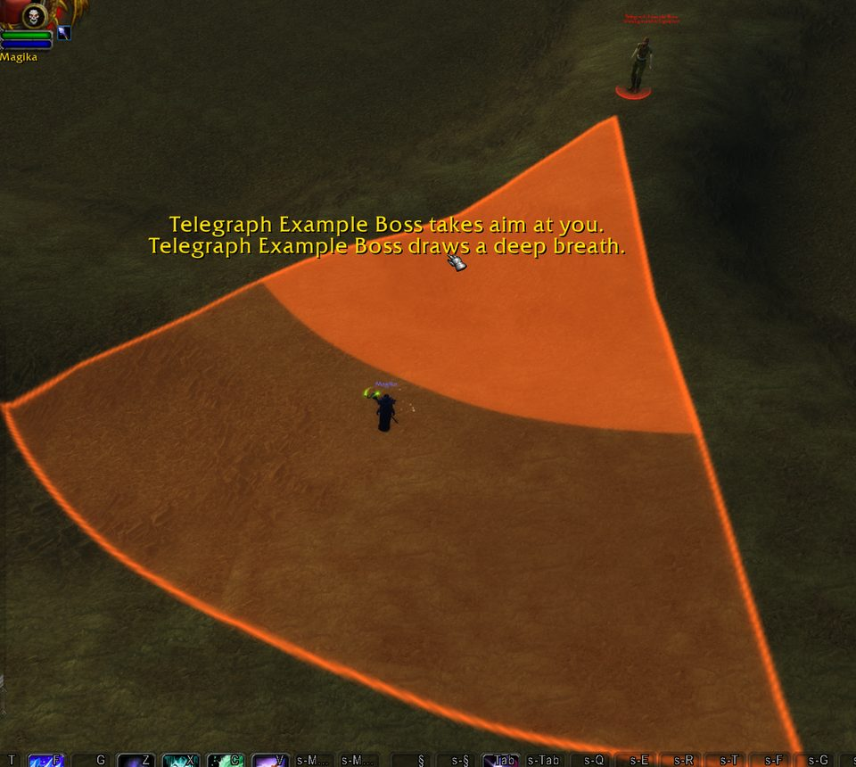
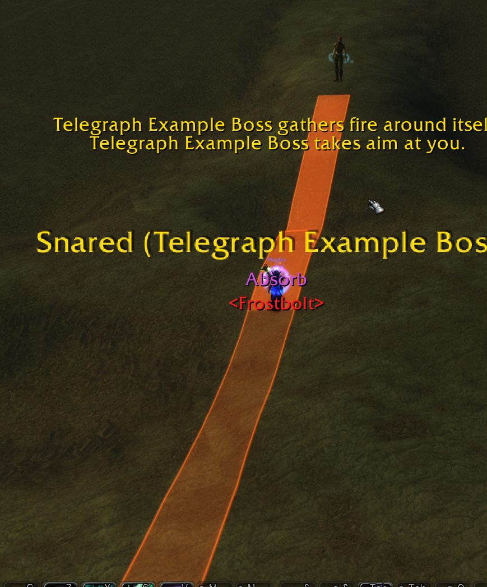
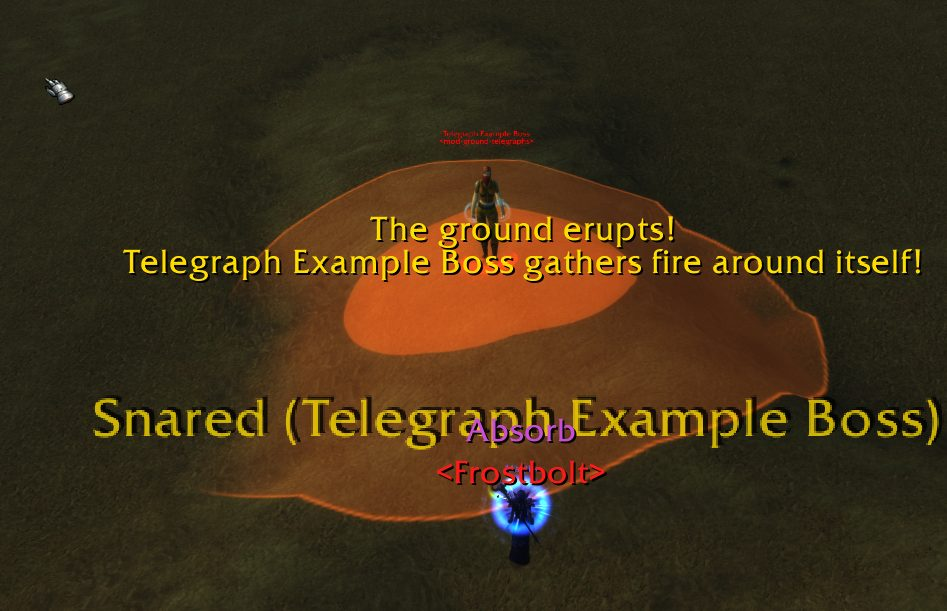
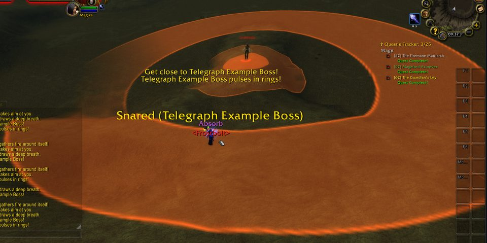
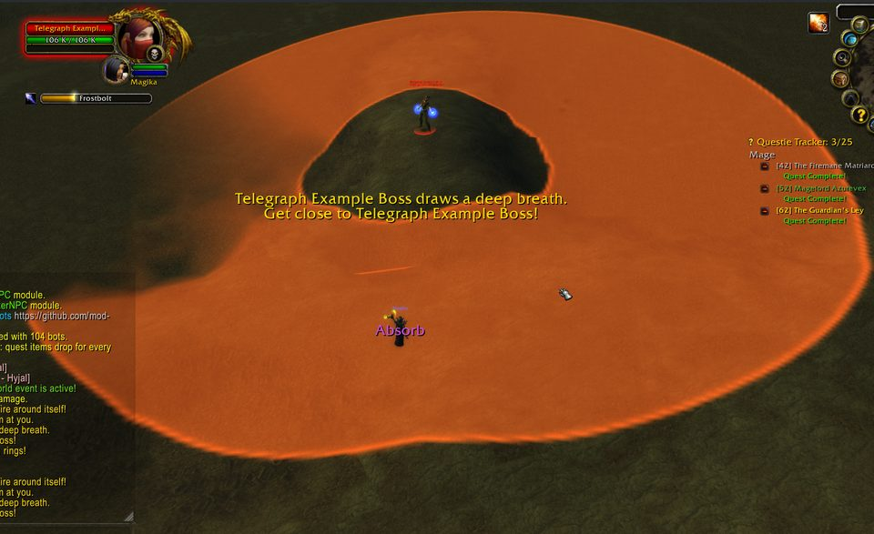
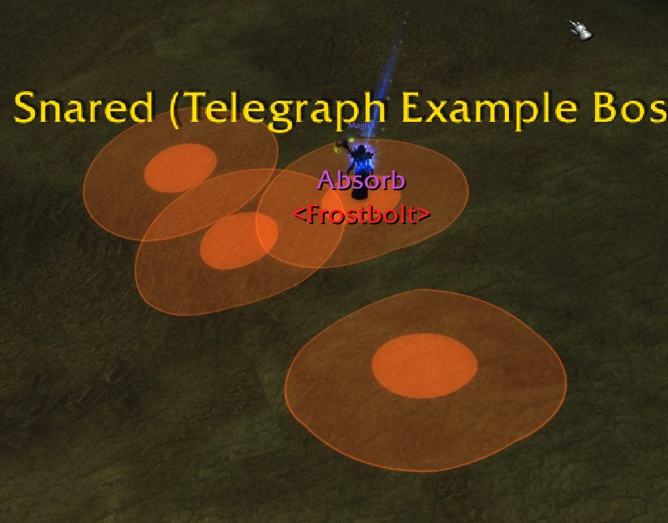
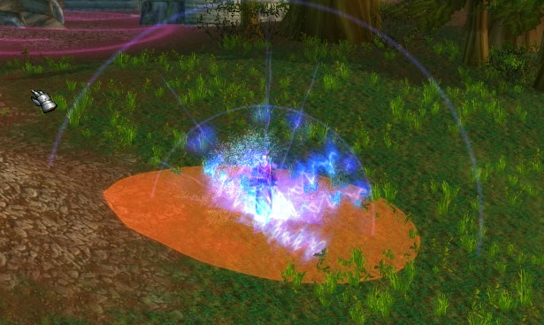
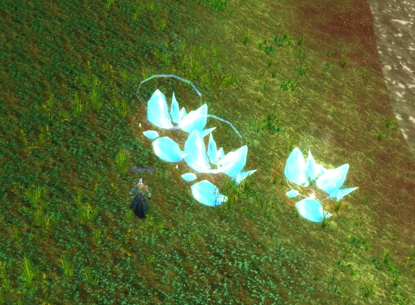
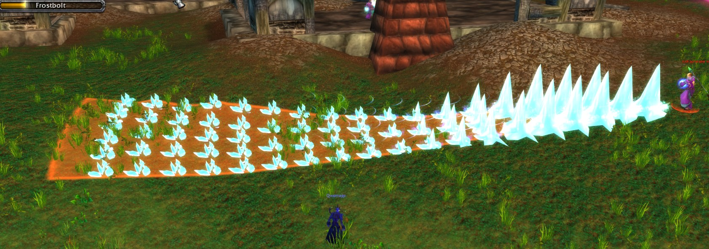

# mod-ground-telegraphs

Retail-style ground telegraphs for AzerothCore (WotLK 3.3.5a): lines, cones, novas and donuts painted **on the ground**
that follow terrain and building floors, sized exactly to the area an attack will hit, with a fill that grows to the
edge when the hit lands. Plus data-driven telegraph bosses you can make with SQL only.

- Exact sizes: a 2 x 40 yd beam, a 60° cone of 30 yd, a 10 yd nova, a 20–40 yd donut look exactly as big as they hit.
- They lie on the ground like the spell targeting circle (terrain, building floors, uneven ground).
- Hostile marks are orange-red, friendly (heal) marks green.
- A fill grows from the boss to the edge over the cast time (the donut fades in), so players see when it lands.
- A C++ API any module or script can call, a GM command to preview, and an SQL-driven boss AI.
- Self-made art: no Blizzard or retail files are shipped (see [Why no Blizzard files](#why-no-blizzard-files)).
- Our test notes on projected textures, model writing and what did not work: [FINDINGS.md](FINDINGS.md).
- Changes per version and how to upgrade from 1.0: [CHANGELOG.md](CHANGELOG.md).

## Screenshots

| | |
|---|---|
|  |  |
| Cone, 60° x 30 yd, the fill halfway | Line, 2 x 40 yd, over a hill |
|  |  |
| Nova around the boss | Dance: a nova and a donut at once |
|  |  |
| Dance, the inverse ring (stand near the boss) | Erupt: small novas on and around the target |

Attack visuals (1.1): SpellVisualKits going off as the marks clear.

| | |
|---|---|
|  |  |
| An arcane nova on its mark | Ice spikes erupting on erupt marks |


A frost wave running out over a cone (`visual_mode` wave)

## How it works

The 3.3.5a client can draw a model's texture as a *projected texture* (skin batch flag `0x4`): instead of drawing the
triangles it paints the texture down onto whatever is below, terrain and buildings alike. A projected batch paints the
whole box of each triangle, so each mark is one quad per layer (area, rim, fill) with the shape drawn in the texture's
alpha, and every texture keeps a clear margin (the client's texture clamp would otherwise smear its edge outward).

Every mark is a gameobject with one of these generated models (`tools/telegraph_assets.py`). A model is 1 yd at scale 1;
the server scales it to the exact size and tilts it to the slope, and picks the model variant with the right proportion
(line length / width, cone angle, donut inner / outer) and fill duration. Hit tests are exact geometry on the server.

## Requirements

- AzerothCore (wotlk master; 1.1 compile-checked against master of 2026-11-28, also runs on the Playerbots fork).
- WoW 3.3.5a (12340) clients with the module's client patch (one MPQ).
- Only to rebuild the client files yourself: Python 3 with Pillow (`pip install pillow`) and an MPQ tool.

## Install

**Server**

```bash
cd azerothcore/modules
git clone https://github.com/RockNetEngine/mod-ground-telegraphs.git
cd ../build && cmake .. && make -j$(nproc) worldserver && make install
```

The SQL in `data/sql/db-world/` is applied by the DB updater at the next start (tables, the mark variants and their
`gameobjectdisplayinfo_dbc` rows, and the visual caster creature). No server DBC file needs to change.

**Client**

The client needs two things in one patch MPQ (for example `Data\patch-G.MPQ`; delete the client's `Cache` folder after):

1. The art, `Spells\Telegraph\*` (567 files): download `patch-G.MPQ` from the latest
   [release](https://github.com/RockNetEngine/mod-ground-telegraphs/releases), or build it (below).
2. `DBFilesClient\GameObjectDisplayInfo.dbc` with the 252 new display rows. **You build this one yourself**, from the
   `GameObjectDisplayInfo.dbc` your clients use now (extract it from the client, or take it from a patch you already
   ship):

```bash
cd tools
python3 telegraph_assets.py --base path/to/GameObjectDisplayInfo.dbc --out out
```

Then add `out/DBFilesClient/GameObjectDisplayInfo.dbc` to the patch under `DBFilesClient\`, for example with Ladik's MPQ
Editor (open `patch-G.MPQ`, add the file with that path). The client loads **one whole** `GameObjectDisplayInfo.dbc`,
from the last patch that has it, so the patch with the merged file must load after every other patch that ships one.

### Why no Blizzard files

`GameObjectDisplayInfo.dbc` is a Blizzard client data file. We don't redistribute Blizzard files, not even edited ones,
so the release only carries our own art and the generator adds the rows to the file you already have. It also avoids a
real problem: a shipped DBC would wipe out the rows of any other patch that changes the same file. Building it from your
own copy keeps everyone's rows. Everything in this repository (code, models, textures) is our own work.

## Rebuild the client files (optional)

```bash
cd tools
python3 telegraph_assets.py --base path/to/your/GameObjectDisplayInfo.dbc --out out
```

This writes `out/Spells/Telegraph/*`, `out/DBFilesClient/GameObjectDisplayInfo.dbc` (with `--base`) and
`out/ground_telegraph_variants.sql`. Pack the two folders into an MPQ (for example with Ladik's MPQ Editor: add
`Spells` and `DBFilesClient` with their paths) and, if you changed the grid or the IDs, copy the SQL over
`data/sql/db-world/ground_telegraph_variants.sql`.
The shape grid (cone angles, donut ratios, line proportions, fill times, colours) is at the top of the script. Same
input, same bytes.

IDs used (change with `--display-base`, `--go-base`): GameObjectDisplayInfo 9700–9951 (block 9700–9999),
gameobject_template 9530000–9530251 (block 9530000–9530899), creature 9530999 (visual caster), 9530998 (example boss).

## Usage

- **Preview:** `.groundmark line|cone|nova|donut [size] [param] [ms] [friendly]` draws a mark at your feet (GM).
- **C++ API:** `GroundTelegraph::Draw`, `HitMs`, `Contains`, `Remove` (`src/ground_telegraph.h`).
- **Data-driven bosses:** `ScriptName = 'npc_ground_telegraph_boss'` plus rows in `ground_telegraph_boss` /
  `ground_telegraph_attack`: lines, cones, novas, donuts, eruptions, dances, real casts, attack visuals (SpellVisualKits,
  beams, missiles). Example: `data/sql/examples/example_boss.sql`.

Full reference (commands, API, every table column, attack visuals, limits): **[docs/USAGE.md](docs/USAGE.md)**.

## Credits

Built for and play-tested on the RockNetEngine solo / Playerbots server. The projected-texture flag came from 3.3.5
modding forum knowledge (projected ground spell art such as Charred Earth); what we found while testing it is in
[FINDINGS.md](FINDINGS.md). Code, models and textures are original.

## License

MIT, see [LICENSE](LICENSE).
